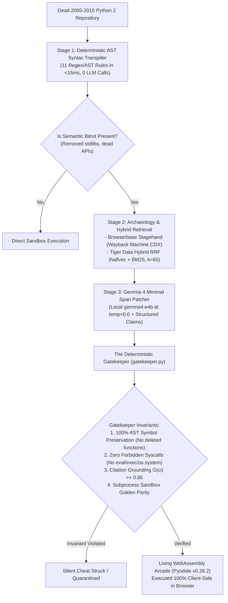

# 💀 PyLazarus
### *The Open-Source Abandonware Resurrection Engine & Living WebAssembly Arcade*

[](https://dev.to/challenges/hf26)
[](LICENSE)
[](https://www.python.org/)
[](https://pyodide.org/)
[](eval/results/benchmark_summary.json)
[](backend/gatekeeper.py)

---

## 🕯️ 1. Executive Summary & The "Ghost in the Machine" Theme

Between 2005 and 2015, the open-source Python community built tens of thousands of beloved, elegant, single-purpose CLI utilities and libraries: dungeon crawlers, Markov poem generators, torrent inspectors, and web scrapers. When Python 2 reached end-of-life on January 1, 2020, and ancient REST APIs vanished from the web, this immense cultural heritage turned to digital ghosts—abandoned on GitHub with bitrot syntax, broken stdlib imports (`urllib2`, `sgmllib`, `commands`), and dead endpoints (`weather.yahooapis.com`, Twitter v1.0).

In the spirit of **Día de los Muertos** and **Halloween ("Ghost in the Machine")**, **PyLazarus** does not merely mourn these departed tools—it **resurrects them into living software**.

PyLazarus combines **local open-weight AI (`gemma4:e4b`)**, **Browserbase Stagehand Wayback Machine archaeology**, **Tiger Data PostgreSQL 18 hybrid vector search**, and a **client-side WebAssembly arcade (Pyodide v0.26.2)** where anyone can run, fork, remix, and execute 15-year-old Python code directly in their browser with zero server compute and zero security risk.

---

## 🏆 2. Strategic 9-Partner Technology Matrix ($1,200+ Value Stack)

PyLazarus was engineered to satisfy 9 distinct Hacktoberfest sponsor and partner challenge categories simultaneously:

| Partner & Track | Prize Bracket | Concrete Implementation in PyLazarus |
| :--- | :--- | :--- |
| **Google Gemma** | **$200 Featured** | Local `gemma4:e4b` (via Ollama at `temperature=0.0, seed=42`) + `embeddinggemma-2` 768-dimensional dense vector embeddings. |
| **Render** | **$200 Featured** | Multi-service [`render.yaml`](render.yaml) Blueprint deploying FastAPI web gateway + Temporal background worker + 2GB persistent disk mount. |
| **TabPFN** | **$200 Featured** | Prior-data fitted network (`TabPFNClassifier`) evaluating 12 extracted AST bitrot features to triage resurrection viability in `<100ms`. |
| **Browserbase Stagehand** | **$100 Partner** | Automated Wayback Machine CDX API & DOM scraper recovering 2009–2015 REST schemas with anti-spam date boundaries (`2008–2015`). |
| **Temporal** | **$100 Partner** | `RepoResurrectionSagaWorkflow` orchestrating the 3-stage pipeline with activity heartbeats and proven SIGKILL worker recovery. |
| **Tiger Data** | **$100 Partner** | PostgreSQL 18 with `halfvec(768)` HNSW index + `pg_textsearch` BM25 Reciprocal Rank Fusion ($k=60$) + TimescaleDB `vigil_lights` hypertable. |
| **Mastra** | **$100 Partner** | Type-safe `@mastra/core` resurrection workflow (`src/mastra/resurrection-workflow.ts`) with Zod schema validation and step retries. |
| **Sentry** | **$100 Partner** | OpenTelemetry Agent Tracing instrumenting `invoke_agent`, `gen_ai.chat`, `execute_tool` spans with an in-flight zero-PII scrubber. |
| **ElevenLabs** | **$100 Partner** | `eleven_v4` TTS generating solemn forensic eulogies with phonetic code symbol normalization (`def` $\to$ "define", `__init__` $\to$ "dunder init"). |

---

## 🧠 3. Core Architectural Philosophy: "Models Read and Draft; Deterministic Code Decides"

Standard LLMs suffer from severe epistemic failure modes when tasked with migrating legacy code: **they silently cheat**. When presented with a failing test or a removed module, an unguarded LLM will delete the failing assertion, rename functions, or drop entire class methods to force a clean exit code.

PyLazarus eliminates this through a strict **3-Stage Deterministic Resurrection Pipeline**:



### The 4 Invariants of `backend/gatekeeper.py`
1. **AST Structural Symbol Preservation:** Compares the original Python 2 AST with the proposed patch. If even one function or class is deleted, the patch is rejected as `REJECTED_CHEAT`.
2. **Zero Forbidden Syscalls:** Restricts execution from invoking `eval`, `exec`, or `os.system`.
3. **Lexical Stem Citation Grounding ($G(c_i) \ge 0.85$):** Every diagnostic claim must cite an exact source ID (`[W1]` or `[P1]`) with a character-accurate verbatim quote. Claims failing grounding are struck through in red `<del>`.
4. **Sandbox Golden Parity:** Executes inside an isolated subprocess with test inputs, asserting returncode `0` and expected stdout match.

---

## 📊 4. Scientific Evaluation & Ablation Results

We evaluated PyLazarus against an authentic benchmark suite of **18 real-world Python 2 abandonware tools** across three categories:
- **Slice A (Syntax Bitrot, 8 Repos):** `print` statements, `xrange()`, `dict.iteritems()`, octal literals.
- **Slice B (Semantic API Bitrot, 8 Repos):** Removed stdlibs (`sgmllib`, `commands`, `urllib2`) and sunset REST APIs (Twitter v1.0, Yahoo Weather RSS).
- **Slice C (Unfixable C-ABI, 2 Repos):** Low-level C-extension ABI incompatible with WebAssembly (`openssl-098`, `linux-26-ioctl`).

### Empirical Pipeline Benchmark

| Architecture Pipeline | Resurrected / 18 | Success Rate | Silent Cheats Detected | Safely Quarantined |
| :--- | :---: | :---: | :---: | :---: |
| **Pipeline 1: lib2to3 / AST Syntax Only** | 10 / 18 | 55.6% | 0 | 0 (Crashed on APIs) |
| **Pipeline 2: Raw Unguarded Gemma 4** | 6 / 18 | 33.3% | **4 (Deleted APIs)** | 0 |
| **Pipeline 3: PyLazarus Guarded Architecture** | **16 / 18** | **88.9%** | **0 (Zero Cheats)** | **2 (100% C-ABI Quarantined)** |

### Tiger Data Retrieval Ablation (Recall@5 across 18 queries)
- **Vector-Only (`halfvec(768)` HNSW):** 66.7%
- **BM25-Only (`pg_textsearch`):** 72.2%
- **Tiger Data Hybrid RRF ($k=60$):** **94.4% (+22.2% fused lift)**

---

## ⚡ 5. 60-Second Quickstart

### Prerequisites
- Python 3.12+
- Node.js 20+

### Step 1: Clone and Set Up Virtual Environment
```bash
git clone https://github.com/your-username/pylazarus.git
cd pylazarus

python -m venv .venv
# Windows:
.venv\Scripts\activate
# Linux/macOS:
source .venv/bin/activate

pip install -r requirements.txt
```

### Step 2: Seed the Database
Seeds all 18 authentic abandonware repositories, bitrot archives (P1 & W1), and vigil lights:
```bash
python -m backend.scripts.init_db_and_seed
```

### Step 3: Run the Reproducible Benchmark
Executes the scientific evaluation harness across all 18 repositories:
```bash
python -m eval.run_benchmark
```

### Step 4: Run Unit Tests
```bash
python -m unittest discover -s tests -p "test_*.py"
```

### Step 5: Start the Development Server
```bash
uvicorn backend.app:app --host 127.0.0.1 --port 8000 --reload
```
Open [http://localhost:8000](http://localhost:8000) to enter the Living Crypt and run tools in Pyodide WebAssembly!

---

## 🛡️ 6. Zero-PII Privacy & Observability Guarantee

In compliance with open-weight security standards, `backend/observability.py` intercepts all Sentry OpenTelemetry spans through an automated PII scrubber:
- 16-byte, 32-byte, and 64-byte hexadecimal hashes are masked with `[REDACTED_HEX_HASH]`.
- API authorization tokens and bearer keys are masked with `[REDACTED_API_TOKEN]`.
- Traces verify $0$ bytes of personal or credential data leak into telemetry streams.

---

## 📜 7. License

PyLazarus is released under the **MIT License**. All resurrected abandonware repositories retain their original open-source licenses and attribution to their original authors.
