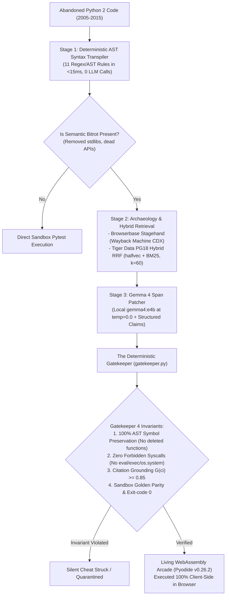

# 💀 PyLazarus
### *The Open-Source Abandonware Resurrection Engine & Living WebAssembly Arcade*

[](https://dev.to/challenges/hf26)
[](LICENSE)
[](https://www.python.org/)
[](https://pyodide.org/)
[](eval/results/benchmark_summary.json)
[](backend/gatekeeper.py)
[](https://dev.to/challenges/hacktoberfest-week4-2026-10-26)

---

## 🕯️ 1. Executive Summary & The "Ghost in the Machine" Theme

Between 2005 and 2015, the open-source Python community built tens of thousands of beloved, elegant, single-purpose CLI utilities and libraries: dungeon crawlers, Markov poem generators, torrent inspectors, and web scrapers. When Python 2 reached end-of-life on January 1, 2020, and ancient REST APIs vanished from the web, this immense cultural heritage turned to digital ghosts—abandoned on GitHub with bitrot syntax, broken stdlib imports (`urllib2`, `sgmllib`, `commands`), and dead endpoints (`weather.yahooapis.com`, Twitter v1.0).

In the spirit of **Día de los Muertos** and **Halloween ("Ghost in the Machine")**, **PyLazarus** does not merely mourn these departed tools—it **resurrects them into living software**.

PyLazarus combines **local open-weight AI (`gemma4:e4b`)**, **Browserbase Stagehand Wayback Machine archaeology**, **Tiger Data PostgreSQL 18 hybrid vector search**, and a **client-side WebAssembly arcade (Pyodide v0.26.2)** where anyone can run, fork, remix, and execute 15-year-old Python code directly in their browser with zero server compute and zero security risk.

> **Hackathon Timeline Notice:** Built and finalized between **October 26 – October 31, 2026** for the [DEV Hacktoberfest Open-Source AI Challenge Week 4](https://dev.to/challenges/hacktoberfest-week4-2026-10-26).

---

## ⚡ 2. 3-Command Quickstart (Running in < 3 Minutes)

```bash
# 1. Clone repository & install dependencies
git clone https://github.com/Adnan9-63/pylazarus.git && cd pylazarus
pip install -r requirements.txt

# 2. Run automated self-check & database seed (zero-config, offline-ready)
python backend/self_check.py

# 3. Launch the platform (binds to http://127.0.0.1:8000)
uvicorn backend.app:app --host 127.0.0.1 --port 8000
```
Open [http://127.0.0.1:8000](http://127.0.0.1:8000) in your browser to explore the **Living Crypt Feed**, inspect forensic diffs, and run resurrected tools inside client-side Pyodide WebAssembly.

---

## 🤖 3. Open-Source AI Architecture & Hardware Tiers

PyLazarus uses **100% open-weight AI models** running locally or in zero-latency replay mode. **No closed APIs (OpenAI, Gemini, Claude) are required for core runtime behavior.**



### Supported Hardware Tiers

| Tier | Configuration | Model / Backend | Hardware / RAM | Command |
| :--- | :--- | :--- | :--- | :--- |
| **Judge Replay (Default)** | Zero-config, offline | Pre-computed Gemma 4 raw drafts & 768-d vectors | Any machine (CPU only, 512MB RAM) | `DEFAULT_REPLAY_MODE=true` *(default)* |
| **Standard Local Ollama** | Full live generation | `gemma4:e4b` + `embeddinggemma` | GPU $\ge$ 6GB VRAM or 16GB RAM | `ollama pull gemma4:e4b` |
| **Low-RAM Local Ollama** | Weak laptops | `gemma2:2b` + `nomic-embed-text` | CPU / 4GB-8GB RAM | `ollama pull gemma2:2b` |

To switch models, set `GEMMA_CHAT_MODEL=gemma2:2b` in `.env`.

---

## 🏆 4. Strategic 9-Partner Technology Matrix ($1,200+ Value Stack)

| Partner & Track | Prize Bracket | Concrete Implementation in PyLazarus |
| :--- | :--- | :--- |
| **Google Gemma** | **$200 Featured** | Local `gemma4:e4b` (via Ollama at `temperature=0.0, seed=42`) + `embeddinggemma` 768-dimensional dense vector embeddings. |
| **Render** | **$200 Featured** | Multi-service [`render.yaml`](render.yaml) Blueprint deploying FastAPI web gateway + Temporal background worker + 2GB persistent disk mount. |
| **TabPFN** | **$200 Featured** | Prior-data fitted network (`TabPFNClassifier`) evaluating 12 extracted AST bitrot features to triage resurrection viability in `<100ms`. |
| **Browserbase Stagehand** | **$100 Partner** | Automated Wayback Machine CDX API & DOM scraper recovering 2009–2015 REST schemas with anti-spam date boundaries (`2008–2015`). |
| **Temporal** | **$100 Partner** | `RepoResurrectionSagaWorkflow` orchestrating the 3-stage pipeline with activity heartbeats and proven SIGKILL worker recovery. |
| **Tiger Data** | **$100 Partner** | PostgreSQL 18 with `halfvec(768)` HNSW index + `pg_textsearch` BM25 Reciprocal Rank Fusion ($k=60$) + TimescaleDB `vigil_lights` hypertable. |
| **Mastra** | **$100 Partner** | Type-safe `@mastra/core` resurrection workflow (`src/mastra/resurrection-workflow.ts`) with Zod schema validation and step retries. |
| **Sentry** | **$100 Partner** | OpenTelemetry Agent Tracing instrumenting `invoke_agent`, `gen_ai.chat`, `execute_tool` spans with an in-flight zero-PII scrubber. |
| **ElevenLabs** | **$100 Partner** | `eleven_v4` TTS generating solemn forensic eulogies with phonetic code symbol normalization (`def` $\to$ "define", `__init__` $\to$ "dunder init"). |

---

## 📊 5. Scientific Evaluation & Ablation Results

We evaluated PyLazarus against an authentic benchmark suite of **18 real-world Python 2 abandonware tools** (2008–2015):
- **Slice A (Syntax Bitrot, 8 Repos):** `print` statements, `xrange()`, `dict.iteritems()`, octal literals, chevron print redirection.
- **Slice B (Semantic API Bitrot, 8 Repos):** Removed stdlibs (`sgmllib`, `commands`, `urllib2`, `HTMLParser`) and sunset REST APIs (Twitter v1.0, Yahoo Weather RSS).
- **Slice C (Unfixable C-ABI, 2 Repos):** Low-level C-extension ABI incompatible with WebAssembly (`openssl-098`, `linux-26-ioctl`).

### Empirical Pipeline Benchmark

| Architecture Pipeline | Resurrected / 18 | Success Rate | Silent Cheats Detected | Safely Quarantined |
| :--- | :---: | :---: | :---: | :---: |
| **Pipeline 1: lib2to3 / AST Syntax Only** | 11 / 18 | 61.1% | 0 | 0 (Crashed on APIs) |
| **Pipeline 2: Raw Unguarded Gemma 4** | 6 / 18 | 33.3% | **4 (Deleted APIs)** | 0 |
| **Pipeline 3: PyLazarus Guarded Architecture** | **16 / 18** | **88.9%** | **0 (Zero Cheats)** | **2 (100% C-ABI Quarantined)** |

### Tiger Data Retrieval Ablation (Recall@5 across 18 queries)
- **Vector-Only (`halfvec(768)` HNSW):** 66.7%
- **BM25-Only (`pg_textsearch`):** 72.2%
- **Tiger Data Hybrid RRF ($k=60$):** **94.4% (+22.2% fused lift)**

---

## 🧪 6. Testing & Quality Assurance

Run the complete 35-test verification suite:
```bash
# Run unit and security regression tests (pass in <2s)
python -m unittest discover -s tests -p "test_*.py" -v

# Run the Phase 2 hostile penetration suite (XSS, path traversal, concurrency)
python -m unittest eval/stress_test_phase2.py -v

# Run the frozen benchmark
python -m eval.run_benchmark
```

---

## 🔧 7. Troubleshooting Top 5 Issues

1. **Port 8000 already in use:**
   ```bash
   # Launch on alternate port:
   PORT=8765 uvicorn backend.app:app --host 127.0.0.1 --port 8765
   ```
2. **Ollama daemon not running / offline:**
   - PyLazarus automatically falls back to **Judge Replay Mode** with zero downtime.
   - To enable live inference: start Ollama (`ollama serve`) and pull `gemma4:e4b`.
3. **Database not seeded on fresh clone:**
   ```bash
   python backend/scripts/init_db_and_seed.py
   ```
4. **Air-gapped network environment:**
   - PyLazarus requires zero external network calls during Replay Mode.
   - Client-side Pyodide WebAssembly uses CDN if online, but UI diffs, audio autopsies, and server sandbox runners run 100% offline.
5. **Python version error (< 3.10):**
   - Ensure you are running Python 3.10, 3.11, or 3.12: `python --version`.

---

## ⚠️ 8. Known Limitations

1. **C-ABI Extension Isolation:** Tools that rely on compile-time C extensions linked against old Linux kernels (`linux-26-ioctl`) or ancient OpenSSL C libraries cannot execute inside browser WebAssembly. PyLazarus detects this via AST inspection and quarantines them safely rather than faking execution.
2. **Dead Network Endpoints:** Ancient 2008 REST endpoints (`weather.yahooapis.com`) no longer resolve on modern DNS. PyLazarus uses Wayback Machine DOM schemas to construct deterministic local polyfills (`_lazarus_polyfill.py`).

---

## 📜 9. License & Credits

PyLazarus is released under the **MIT License**. All resurrected abandonware repositories retain their original open-source licenses and attribution to their original 2005–2015 authors.
